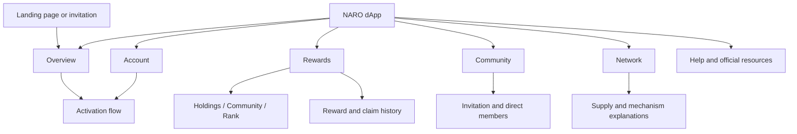
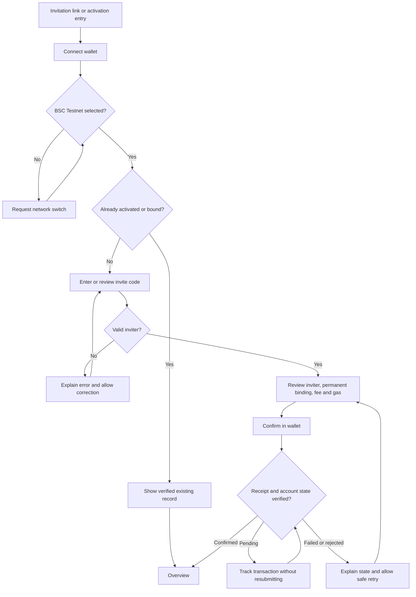

# NARO product structure

Version: 1.0 proposal · 19 October 2026 · Initial delivery: BNB Smart Chain testnet

This document proposes the content structure, navigation, and user journeys for the NARO dApp revamp. It gives the wireframes a working specification. No production routes, contracts, economic rules, or live website content have changed.

## Product direction

Make the dApp the place where a participant understands their NARO position, completes activation, checks rewards, and manages their community. Keep NARO's broader asset-issuance story available through About and official documentation.

The existing landing page describes asset issuance, community growth, trading, liquidity, and AI opportunity discovery. The inspected dApp exposes rewards, referral participation, account activation, and network statistics. The first release should make those available functions easy to understand. A landing-page claim alone does not establish an available application feature.

Working audiences:

- A new participant arriving through the landing page or an invitation, who needs to understand the requirements before connecting and activating.
- A returning participant checking claimable rewards and settlement history.
- A community builder checking direct members, community holdings, and referral participation.
- A visitor checking public network information without connecting a wallet.

These audiences are working assumptions based on the current screens; validate them with the client before final visual design.

## Brand translated into product behavior

| Existing brand signal | Proposed use in the dApp |
| --- | --- |
| Dark backgrounds and mint-green accent | Keep a consistent dark product surface; use mint for the primary action and selected navigation. Give errors and warnings their own accessible treatment. |
| Angular NARO wordmark and technical imagery | Preserve the supplied logo. Use clear grouping, precise numeric alignment, and readable status labels. |
| Friendly Naro mascot | Use in onboarding, completion, and empty states. Keep transaction amounts, fees, and irreversible choices easy to scan without mascot decoration competing with them. |
| Radar and connected communities | Use a shared participation summary: activation status, settled holdings, rewards, and community access. Any later radar graphic must encode meaningful data or stay decorative. |
| Ecosystem and community story | Make Community a main destination; link broader ecosystem information through About and Help. |

Domain vocabulary: issuance, settlement, holding zones, community branches, referral binding, reward ledger, network activity, and token supply.

Visual references already observed: near-black surfaces, deep green panels, mint actions, white primary text, muted green-gray labels, and metallic brand artwork. Exact design tokens require a later computed-style or source audit.

Proposed signature: a NARO participation summary that gives each wallet one clear next action. Show what needs attention before secondary statistics. A disconnected visitor sees an introduction; an unactivated wallet sees setup; an active wallet sees its current position.

Avoid an automatically rotating promotion as the only explanation of setup; use a persistent checklist. Avoid giving every metric equal visual weight; lead with the current task. Avoid adding Launch, AI, or Swap as working product destinations until their available flows and integrations are verified.

## Proposed information architecture

Use the same five destinations on desktop and mobile:

| Destination | User question | Main content |
| --- | --- | --- |
| Overview | What is my current position, and what should I do next? | Participation status, next action, rewards summary, holdings context, community summary, network preview. |
| Rewards | What can I claim, how was it calculated, and what happened before? | Claimable rewards, reward categories, settlement details, reward and claim history. |
| Community | Who invited me, and how is my community participating? | Inviter status, invite link/code when eligible, community power, direct members, calculation explanations. |
| Network | What is happening across NARO? | Supply, output, burns, holders, emission stages, allocations, and documented mechanism information. |
| Account | Which wallet is connected, and is my account ready? | Wallet/network, activation status, inviter record, account actions, language and support links. |

Global utilities: wallet/network control, language, Help, official links, and a persistent BSC Testnet indicator in the test release.

Desktop: a stable navigation rail or full-width application header with a wider content area. Mobile: five labeled bottom destinations with sufficient space above the bar for page actions. Wallet, language, and Help remain available without taking another bottom-nav slot.

Swap is a release-dependent utility. The inspected mobile entry reports that it is not open. Keep its route recoverable if the source contains one; do not present it as an executable action until a usable integration exists. If the client wants future-feature visibility, use a clearly labeled informational entry under About rather than a dead primary destination.

## Existing content and route mapping

Navigation labels below are proposed changes for the review prototype. Keep existing deep links working during implementation; a label change does not require a route rename.

| Existing location | Proposed location | Treatment |
| --- | --- | --- |
| Home, `/` | Overview, `/` | Replace the marketing-first order with a status-aware overview. |
| Mining, `/mining` | Rewards, `/mining` | Make claim status and settlement information the focus. |
| Static reward tab | Holdings within Rewards | Keep the term Static in contextual help and data mapping. |
| Promo reward tab | Community within Rewards | Show the reward result here; manage invites and members in Community. |
| Rank reward tab | Rank within Rewards | Explain the daily snapshot and weighted rank. |
| Invite Friends / My Team, `/mining/community` | Community, same route | Promote the existing view to main navigation. |
| Data, `/data` | Network, `/data` | Group public metrics by meaning and freshness. |
| Me, `/mine` | Account, `/mine` | Make wallet, activation, and inviter status explicit. |
| Earnings, `/mine/earnings` | History under Rewards, existing route retained | Use one ledger destination, linked from Rewards and Account. |
| Register & Activate, `/activate` | Shared activation flow, same route | Reachable from Overview, Account, Community, and referral entry. |
| Quick Tour, `/?guide=1` | Help / replay introduction | Preserve the known entry while replacing dependence on the promotional carousel. |
| About, capabilities, partner descriptions | Compact About entry and official documentation | Preserve provenance and client-approved copy; reduce repeated marketing content in task screens. |
| FAQs | Contextual help plus a searchable/organized Help destination if scope allows | Put binding help beside binding, reward help beside rewards, and supply rules beside network data. Search itself is optional. |
| Social links and official documents | Help and official resources | Keep a consistent set of verified destinations. |

Proposed naming changes improve comprehension; they must not change reward classifications in contracts or the backend. Search and support copy should recognize both the old and new terms during transition.

## Content order by screen

### Overview

Purpose: identify the participant's current state and offer the next useful action.

Disconnected order:

1. Title: **Your NARO overview**.
2. Description: **Track your rewards, follow your community, and explore NARO network activity.**
3. Primary action: **Connect wallet**. Secondary link: **Explore network**.
4. Short participation explanation: connect a wallet, review the invitation, then complete activation. Mention that activation involves a transaction and a fee before asking the person to start.
5. Public network preview, with freshness and unavailable states.
6. About NARO and links to rules and official resources.

Connected order:

1. Wallet participation status and any incomplete setup.
2. One contextual action: complete activation, review claimable rewards, or review the latest settlement.
3. Claimable rewards and category breakdown.
4. Settled holdings, clearly distinguished from current wallet balance.
5. Community summary with a link to Community.
6. Network preview and optional announcement.

Do not show a disconnected wallet a numeric zero as if its personal data has loaded. Public figures can still load independently.

### Rewards

Title: **Your rewards**. Supporting copy: **Review settled rewards and claim eligible NARO to your wallet.**

Content order:

1. Claimable NARO, as reported by the verified claim source; show data freshness.
2. Contextual action: connect, switch network, complete required setup, claim, or explain why claiming is unavailable.
3. Latest settlement and cadence. Show an exact next-settlement time only when a reliable timezone/schedule or contract source exists.
4. Category tabs: **Holdings**, **Community**, **Rank**. Each explains eligibility, the applicable snapshot, personal weight/share, and the current category amount when available.
5. **History**: reward accrual and claim records, with status, timestamp, category, amount, and transaction link where one exists.
6. Rules and support.

Keep claimable, accrued, and claimed amounts distinct. An accrued ledger entry does not establish that tokens are already in the wallet or immediately claimable. Do not invent an APR or extrapolate a guaranteed return from a daily snapshot.

The inspected UI has one claim summary above its categories. Preserve that model until the contract confirms whether claims are aggregate, separate by category, or otherwise constrained.

### Community

Title: **Your community**. Supporting copy: **View your inviter, share your invitation, and follow community participation.**

Content order:

1. Participation/activation status, including the next setup step if needed.
2. Bound inviter, or an explicit unbound status. Once bound, show it as a record rather than an editable field.
3. Invite code and share/copy action, only when the existing eligibility rules allow it.
4. Community power, direct referrals, and community holdings, with their source and snapshot context.
5. Direct member list; branch detail only if existing data supports it.
6. **How community power works**, using the approved formula and examples checked against the implementation.

Reward amounts link to the Community category in Rewards. Community membership and branch data remain here, avoiding two competing management screens.

### Network

Title: **NARO network**. Supporting copy: **Explore supply, reward output, and burn activity.**

Content order:

1. Network identity, data source/freshness, and retrieval status.
2. Supply and cumulative burns, with clear definitions and units.
3. Current reward-output stage and output figures.
4. Pool burn details; show a countdown only when its triggering mechanism and timing are verified.
5. Holder count and allocation breakdown.
6. Mechanism explanations: fees, burn rules, circuit breaker, and recovery/buyback behavior.

Separate observed metrics from static economic-model descriptions. Attribute unverified rules to project documentation. Never present an unavailable read as infinity, a fabricated trend, or an actual zero.

### Account

Title: **Your account**.

Order: wallet address and network; activation status; inviter record; transaction/activation receipt where available; reward-history link; language, Help, official resources, and disconnect.

Wallet connection and account activation are separate states. The interface should never describe a connected wallet as activated without checking the appropriate source.

### Help and About

Organize help by user question: getting started, invitations/activation, holdings and settlements, claims, community/rank rules, network mechanisms, and troubleshooting.

Keep partner attribution and the broader issuance/AI/trading story in About using client-approved wording. The landing page can continue to carry the full brand narrative. Preserve existing legal and risk copy until the client supplies approved replacements.

## User journeys

### New visitor

Landing page or direct visit → Overview → understand participation requirements → Connect wallet → check/switch to BSC Testnet → read account and inviter status → complete only the missing setup → Overview.

Allow public Network and Help browsing before connection. Do not force a signature solely to read public data.

### Invitation and activation

Keep valid invitation context through connection and network switching, but never bind merely because a URL contains a code. Recheck chain, wallet, inviter, and quote before submission. Invalidate stale wallet-specific data when the wallet changes.

The review must identify the actual inviter, display a verified current fee, distinguish it from estimated network gas, and state the permanent relationship before confirmation. The observed live fee of 0.00002 BNB is evidence of current UI copy, not an approved testnet constant.

No invite code: keep public browsing available and explain how to obtain a valid invitation through verified project channels. Do not auto-assign a default inviter. Whether a no-invite activation path exists needs source/client confirmation.

### Returning participant claiming rewards

Overview → Rewards → inspect claimable amount and settlement details → check network and gas → review claim → confirm in wallet → pending status with transaction link → verify receipt and refresh claim state → History.

Only show an approval step if the actual contract requires it. Separate wallet confirmation, submitted transaction, and confirmed execution. A rejected signature does not reduce the claimable amount. Do not mark a claim successful from a transaction hash alone.

If a user enters Rewards directly, apply the same connection, network, eligibility, and loading checks there; do not require a detour through Overview.

### Community builder

Overview or Community → confirm active status → copy eligible invitation link → inspect direct members/community power → read calculation help → open Community rewards if needed.

Opening an invitation or copying a link must never sign or send a transaction. Preserve the distinction between direct referrals, branches, and the total community if the backend exposes those concepts separately.

### Public network inspection

Overview or direct Network link → read available metrics and their freshness → open calculation/mechanism explanation → open official documentation or an explorer when appropriate.

Wallet connection is unnecessary for public metrics. An unavailable service should leave the definitions and other available data readable.

## Content and state rules

| State | Content and action |
| --- | --- |
| Disconnected | Explain what connection enables; hide personal values behind a clear prompt. Keep public information accessible. |
| Wrong network | Name BSC Testnet and provide a switch action. Do not mix values from different chains. |
| Connected, not activated | Show verified status and a Complete activation action only where activation is required. |
| Loading | Use a labeled loading placeholder; keep the layout stable. |
| Valid zero | Show zero with the correct unit after a successful read. |
| Empty records | Explain that no records exist for the current scope/filter. |
| Read unavailable | Show Data unavailable and a scoped retry; preserve other usable sections. |
| Stale snapshot | Show the snapshot timestamp and explain which values depend on it. |
| Wallet confirmation | Name the action being requested; disable only the affected action. |
| Transaction pending | Show status and transaction link; prevent accidental duplicate submission. |
| Transaction rejected/failed | Explain whether anything was submitted and preserve recoverable input. |
| Confirmed | Verify the transaction result, refresh relevant data, and show the receipt or history entry. |

For testnet, state that tokens and activity are for testing. Do not attach a real-dollar valuation to test assets. Any sample metrics in wireframes must carry a visible Sample data label.

Use units on amounts, distinguish live balance from settled balance, use readable precision, and make complete addresses available alongside shortened displays. Support keyboard navigation and meaningful labels for status, help, filters, and transaction controls.

## Suggested copy changes

| Existing wording/pattern | Proposed wording/pattern |
| --- | --- |
| Mining Rewards | Your rewards |
| Pending claim | Claimable rewards, only when the source confirms eligibility |
| Static | Holdings, with Static in explanatory text |
| Promo | Community, with Promo in explanatory text |
| Me | Account |
| Bind invite | Review inviter, followed by an explicit confirmation |
| Generic empty personal figures | Connect your wallet to view your rewards. |
| No records for this type | No reward records match this filter. |
| Ledger/wallet ambiguity | Settled rewards appear here. Tokens reach your wallet after a confirmed claim. |
| Infinity on an unavailable metric | Data unavailable. Try again. |
| Invitation warning hidden in FAQ | Your inviter cannot be changed after confirmation. Check the code and address carefully. |

Use clear, calm language around money and permissions. Keep playful mascot language to onboarding and optional moments. Do not add claims of guaranteed profit, verified partnerships, complete decentralization, or automatic execution without evidence and approved wording.

## Wireframe scope and review checks

First wireframes: Overview (disconnected, setup incomplete, active), Rewards (claimable, zero, pending), activation review, Community, Network, and Account. Include a mobile layout and a desktop layout using the same navigation labels and content hierarchy.

Acceptance checks:

- Every item from the observed content inventory has a destination or a documented release-dependent treatment.
- New and returning participants have a clear next action, including direct deep-link entry.
- Claiming and reward history use one consistent model of accrual, eligibility, and confirmation.
- The invitation review exposes the permanent relationship and total expected transaction cost before signing.
- Connected, activated, and eligible states remain distinct.
- Public information works without a wallet.
- Testnet/sample data, live data, static documentation, and unavailable data cannot be mistaken for one another.

## Open decisions before implementation

| Decision | Why it matters | Current proposal |
| --- | --- | --- |
| Confirm proposed navigation and reward labels | Affects client terminology, localization, and user familiarity. | Overview / Rewards / Community / Network / Account. Retain old terms in help and internal mappings. |
| Source and contract/API availability | Determines actual loading, account, referral, and claim states. | Request source, ABIs, API definitions, and testnet deployment details before integration. |
| Exact relationship between binding and activation | Determines the number of transactions and recoverable intermediate states. | Draw one guided journey; do not assume one transaction implements both. |
| Eligibility, snapshot timing, and claim authority | Determines claimable vs accrued values and time labels. | Preserve observed semantics and verify against implementation. |
| Swap/asset issuance/AI availability | Determines release navigation and feature promises. | Keep unverified functions out of executable primary navigation. |
| Required languages and approved terminology | Determines navigation fit and financial explanation quality. | English proposal; inventory existing locales before replacing strings. |

## Evidence and limits

See [current-state evidence](naro-current-state.md) for inspected routes, observed semantics, and source references. This is an IA/content proposal, not a contract audit or verification of the project's commercial claims.
